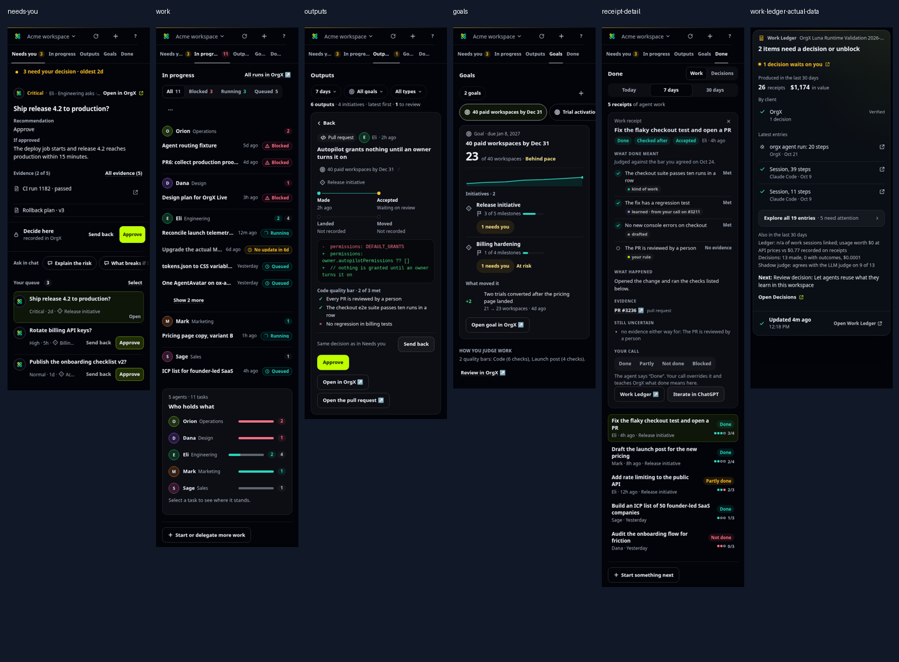

# OrgX widgets: design, interaction, and data review

Reviewed October 27, 2026. Code: `orgx-mcp` at `cf4620e`; supporting sources in the checked-out OrgX application and UI kit. This is an audit and implementation brief; product code was not changed.

The biggest obstacle to a 10/10 experience is the amount of interpretation left to the person. They must distinguish receipts from work, recorded from verified, a judgment from its downstream execution, a clickable row from a static row, and a summary count from a different ledger's count. The styling is coherent, but the information and interaction contracts are less consistent.

The highest-return change is to make every view answer the same four questions: **What changed? What does it mean? Does it need me? What happens if I act?** Put the answer and the action together. Move provenance detail and technical diagnostics behind clear disclosures.

## Scope and evidence

- All 15 widget surfaces in `_manifest.json`, plus a source review of the gallery. The inventory includes the demo-only streaming scaffold.
- Org panel: Needs you, In progress, Outputs, Goals, Done/Work, receipt detail, start, agreement, question and item forms, and loading, empty, auth, stale, degraded and permission states.
- Desktop and 375px captures; the existing sweep also exercised 768px and 1440px, plus reduced motion.
- Current local renders of the code and shipped fixtures. The live operator brief and receipt list were read through OrgX for the authorized **OrgX Luna Runtime Validation 2026-09-27** workspace, then the returned brief was rendered locally without changing its data.
- No production writes, approvals, messages to people, or dispatches. Interaction writes ran against synthetic tool responses.

The 53 referenced screenshots are included in [`assets/widget-ux-2026-10-27/`](assets/widget-ux-2026-10-27/). Raw live payloads and audit-local scripts remain uncommitted under `artifacts/qa/ux-deep-pass-2026-10-27/`; [the validation summary](assets/widget-ux-2026-10-27/validation-summary.json) records the check results and targeted probe observations. The older render script hardcodes `2026-07-17` in its output directory; this run's captures are newly generated under `artifacts/widget-audit/2026-07-17/ux-deep-pass-2026-10-27/`.

This contact sheet resizes the current captures for comparison. Individual screenshots below are the originals. Empty/transient captures were not used as proof of a loaded view: specifically, the fast-capture Decisions desktop and phone images were rejected in favor of stable render-sweep images, and the gallery's direct `done` route showed a skeleton; the accepted receipt screenshots were reached by clicking Done and opening a receipt.

## What already works

The restrained dark palette, shared avatars, status chips and clear primary-action color provide a useful foundation. Evidence, consequences and decisions can appear together. The panel already has roving tab focus, focus restoration, reduced-motion handling, request coalescing, workspace-generation guards, deferred repaint while typing, and a shared live connection machine. Reuse these; this does not call for a framework rewrite.

The Outputs view's distinction between Made, Accepted, Landed and Moved is valuable. The newer receipt contract also preserves producer claims separately from human judgments. Those distinctions should become the common vocabulary across the rest of the product.

## Highest-priority findings

| ID | Priority | Finding and evidence | Concrete correction |
| --- | --- | --- | --- |
| F01 | P1 | Event collapsing loses identity and proof state. In a targeted render, four same-title/source PR events, including a failure, became one green `Repeated work ×4` row linking only the first PR. The explorer disappeared because the collapsed length was one. | Group by a durable entity/run identity and compatible state; preserve each member and destination. Show a mixed-state aggregate or the most actionable state. Never deduplicate distinct PRs solely by text. |
| F02 | P1 | `tierOf()` and `tierWord()` use `/verif/i`; a legitimate-looking `Unverified` label rendered as `Verified` with a green check in a targeted payload. | Map the typed `evidenceState` enum. Unknown values remain unknown; display labels must never determine proof. |
| F03 | P1 | In the actual workspace, the summary reports **26 receipts**, while `orgx_list_work_receipts` returns **0**. Source inspection explains a real cohort difference: the Chronicle counts execution receipts broadly, while the receipt ledger requires a portable receipt document and specific ref types. | Name the cohorts: e.g. execution records versus reviewable work receipts. Prefer a reconciled response that supplies both counts, their windows and links. Never promise a receipt list that cannot contain the headline count. |
| F04 | P1 | The actual brief says approximately **$1,174 estimated labor value**. The widget drops the basis and qualifier and shows **$1,174 in value** beside produced counts. | Show `Estimated labor value ≈ $1.17k` in a secondary summary, with its method available. Keep measured revenue, estimated avoided labor and recorded cost separate. |
| F05 | P1 | The explorer promises `Explore all` / `Every Work Ledger entry`, but it is built from a bounded Chronicle preview. The actual response supplied 24 events, rendered as 19 collapsed entries, alongside 245 provenance records. The checked-out server caps this event list at 24. | Say `Explore 19 recent groups` or `Recent activity preview`; expose coverage and a true paginated destination. Do not imply the 245 records are all present. |
| F06 | P2 | Calendar-only deadlines are parsed as instants. A targeted Chicago run renders `2026-12-31` as **Dec 30** in `goalMeta()`. The gallery also exhibits a date shift. | Parse calendar dates as year/month/day without a timezone conversion; use the time formatter for timestamps only. |
| F07 | P2 | Criterion pips hide bad states at volume: `{met:8, unmet:1, unknown:1}` with an eight-pip cap shows eight green pips and `8/10`. The accessible label is truthful, but the visual signal omits both exceptions. | Use a proportional three-part strip with text, or reserve exception marks before successful marks. Show `8 met · 1 failed · 1 unproven` when space permits. |
| F08 | P2 | On phone views with loaded count badges, the panel navigation truncates to `Needs y…`, `In progr…`, `Outp…`, `Go…`, `Do…`. Unknown badges initially absent then consume space. | Use compact, stable labels and semantic icons: Needs you / Work / Outputs / Goals / History. Reserve badge space, or allow nonshrinking horizontal tabs with a visible overflow cue. |
| F09 | P2 | Phone receipt detail is inserted above the entire list; the close control is a small ×. Outputs already uses a Back pattern and hides the list while a detail is open. The receipt screen is roughly 1,450px tall in the captured fixture. | Reuse the existing `is-push` master/detail pattern and `backHtml()` for receipts. Restore the selected row and scroll on Back. |
| F10 | P2 | “Top priorities” in Morning Brief and “Linked” items in Entity Card look navigable but render as static text. Source builders omit per-item links. | Make titles/full rows open the exact record when an ID/link exists. If the payload lacks a destination, add it upstream or make the noninteractive treatment explicit. |
| F11 | P2 | Receipt evidence always uses a green `met` row, even when the card headline says verification is producer-reported and unconfirmed. | Use a file/link/test icon to mean evidence exists; reserve a check for an explicitly assessed passing result. Distinguish existence, result and provenance. |
| F12 | P2 | `Done` includes partly done, not done, blocked, unchecked and unaccepted work. A producer reporting success and a human accepting work can therefore feel like the same state. | Rename the view History or Work record. Keep outcome, verification, acceptance and delivery as separate fields. Offer a Needs review filter. |
| F13 | P2 | The actual ledger hides Claude Code from “By client” despite its 191 emissions and 2,765 verified completed nodes. The widget only admits clients with sessions, artifacts, decisions or PRs. | Include meaningful activity/record/run counts in eligibility; choose a relevant, human-readable subtitle for each client. Separate connection health from recorded evidence. |

P1 means fix before relying on the surface for operator judgment; P2 means a material clarity, interaction or visual defect. These priorities are product judgments, not measured usability scores.

## The org panel, view by view

### Panel shell and navigation — usable, with significant phone friction

Evidence: [desktop](assets/widget-ux-2026-10-27/orgx-panel-needs-you-800.png), [phone with loaded badges](assets/widget-ux-2026-10-27/orgx-panel-work-375.png).

The workspace switcher and compact shell are good. The five text tabs become hard to recognize as badges load. The header mixes navigation, refresh, creation, help and live status in a narrow strip, without giving a first-time person an obvious order of use.

- Add consistent 16px type/action icons from the existing icon modules; keep labels for navigation. Use 44px hit areas independently of glyph size.
- Reserve count-badge geometry so background reads do not change tab label widths. Distinguish a badge counting all records from one counting only items needing action.
- Keep workspace and navigation stable through loading, errors and selection changes. Use one status location for freshness; a live connection and a recent data snapshot are different signals.
- Prefer an optional contextual introduction over the automatic modal tour. During transition testing the 600ms auto-tour appeared over a ready queue and intercepted the next click; returning-user tests deliberately suppress it. First-use behavior needs its own acceptance test.
- Preserve the current logical keyboard order and accessible tab names when adding icons; do not convert meaningful navigation into unlabeled glyphs.

### Needs you — strong core, too much repeated context

Evidence: [phone](assets/widget-ux-2026-10-27/orgx-panel-needs-you-375.png), [long question](assets/widget-ux-2026-10-27/orgx-panel-long-375.png).

The next decision is clear, and the primary action has a strong visual target. But the queue count, attention banner, urgency, waiting age, recommendation, footer explanation and prompt chips compete for attention. The same queue item appears again under its full detail on a phone.

- Lead with a short action question, then one consequence sentence. If a recommendation only repeats the button's verb, present it as a small “Recommended” marker on that option.
- Make the record identity readable before generic system text. The captured merge-approval fixture has nearly identical queue titles for different PRs; show `Merge PR #18` as the title and put the command/reason in their own fields.
- Keep approval and send-back adjacent in one consistent action bar. Show why an action opens OrgX at the action location, once.
- Collapse the remaining queue behind `Next 2 decisions` on small screens. Preserve navigation to other work without repeating the selected record in full.
- Show evidence state, source and destination together. A record that is a plain document and a source that can be opened should not use an identical row treatment.

State contract: selection produces an immediate selected/loading state while retaining the old detail; a response may replace it only for the current selection/workspace. A lost mutation response needs “Checking whether it was recorded,” then a reconciled result. Recorded approval must never imply downstream deployment or merge completion. The existing reducer already distinguishes these outcomes; retain it.

### In progress — useful grouping, excessive metadata and repeated summary

Evidence: [desktop](assets/widget-ux-2026-10-27/orgx-panel-work-800.png), [phone](assets/widget-ux-2026-10-27/orgx-panel-work-375.png), [detail](assets/widget-ux-2026-10-27/orgx-panel-work-detail-375.png).

Blocked work correctly comes first. Agent grouping supports “who holds this?” The phone layout puts a long task list above a second “Who holds what” summary of the same workload. Titles are compressed to make room for time and status, while an overflow-menu glyph gets its own sparse row.

- Prioritize task name → state/next need → owner/time. Allow two title lines rather than truncating the work's identifying words.
- Keep status width stable, put age on a secondary line when necessary, and distinguish stale information from execution state. “No update in 6d” should not replace the queued/running meaning without context.
- Collapse the workload overview on phones; a compact `5 agents · 11 tasks · 3 blocked` line is enough before expansion.
- Name the overflow menu (“View”) or give it a recognizable layout/group icon; use the same menu placement in Outputs and Goals.
- In detail, put the obstacle and the action that clears it above historical steps. Steering should distinguish a sent chat request from an acknowledged instruction and changed execution.

### Outputs — promising model, unclear miniature encoding

Evidence: [desktop](assets/widget-ux-2026-10-27/orgx-panel-outputs-800.png), [phone](assets/widget-ux-2026-10-27/orgx-panel-outputs-375.png), [empty](assets/widget-ux-2026-10-27/orgx-panel-outputs-empty-375.png).

The four-stage record is a good concept, and the selected output has a useful preview. The four tiny dots in the list require remembering a legend; a person scanning the list cannot immediately distinguish delivered from accepted. The phone detail wraps its four-stage chain into two rows, making a linear lifecycle look disconnected. Review controls and two external destinations create several competing action groups.

- Put a short stage label in each row: `Awaiting review`, `Accepted`, `Merged`, `Published`, or the exact recorded delivery state. Keep dots as a secondary summary.
- Use a vertical timeline on phones and a horizontal chain only where it fits. These are independent observations: allow “merged, acceptance not recorded” without implying a completed sequence.
- Put the next useful action next to the missing stage. Group approve/send-back together; avoid leaving Approve alone on a second line.
- Make the output title/version and rendered artifact the focal point. Expand lengthy checks only when failing/unproven or on request. Retain the ability to inspect all checks before a human decision.
- When changing filters, retain a selected item only if it remains in the result. An empty filtered result should offer `Clear filters`, while an unavailable read should retain prior content and offer Retry.

### Goals — clear metric, missing date and chart semantics

Evidence: [phone](assets/widget-ux-2026-10-27/orgx-panel-goals-375.png), [first goal](assets/widget-ux-2026-10-27/orgx-panel-goals-first-375.png), [unlinked](assets/widget-ux-2026-10-27/orgx-panel-goals-unlinked-375.png).

The large current number is the right anchor. The supporting sparkline has no visible dates, and `sparkHtml()` spaces samples evenly by index even when recorded timestamps are uneven. A trend over a day can look like a trend over months. The progress ring uses current/target while pace uses baseline and direction, so lower-is-better goals can read inconsistently.

- Fix calendar-only dates (F06). Keep a goal's title and structured due date consistent; the current fixture's “by Dec 31” title and computed January due date illustrate why both must come from one source.
- Use elapsed time for the chart's x-coordinate; show first/last date, current value and target. Identify whether `Behind pace` is a linear assumption.
- Use baseline, target and direction for progress. For a goal to reduce latency from 500ms to 200ms, current/target is not progress.
- Make `What moved it` evidence openable when a source is known. State the measurement timestamp and unit; use percentage points for changes in percentage metrics when appropriate.
- `Set goal` currently sends a chat sentence. Label the action `Ask chat to create goal`, or show an explicit draft → request sent → saved transition. A successful send is not a saved goal.

### History / Work receipts — priority redesign within the existing patterns

Evidence: [receipt list](assets/widget-ux-2026-10-27/orgx-panel-receipts-800.png), [phone detail](assets/widget-ux-2026-10-27/orgx-panel-receipt-detail-375.png).

This view contains the information people need to judge work, but it is called Done even when the list contains failed work. The detail spends many vertical sections on “What done meant,” “What happened,” “Evidence,” “Still uncertain” and “Your call.” Some uncertainty repeats a check already marked No evidence. The full list remains below the detail, unlike Outputs. A receipt already accepted in the fixture still presents a new call with no current choice selected.

- Rename Done to History or Work record. Default to a meaningful filter such as `Needs review`, and offer all outcomes.
- Use the existing push-detail pattern on phones with a Back control and restored list position. Keep a compact sticky title/action region for long receipts after confirming actual host-height behavior.
- Lead with the work's result and `3 of 4 checks evidenced · 1 missing review`, followed by the next useful action. Expand the successful checks; keep failed/unproven checks visible.
- Show provenance once at the correct scope: `Agent-reported` or `Reviewed by … on …`. Avoid repeating a qualification on every line while still preserving it per field in the data model.
- Link each criterion to the exact supporting evidence, rather than placing an unrelated evidence list below the whole checklist. `evidence_ids` already exists in the operation contract; the frontend normalizer preserves extra criterion fields but the renderer does not use the mapping.
- Replace capped first-N pips (F07) with an honest aggregate. Add a visible source label to the outcome: agent report versus human judgment.
- If a human judgment exists, show the recorded verdict and reviewer. Offer `Change your call` explicitly when supported; the current saved state disables all choices until the view is recreated. A failed save should keep the draft choice and provide a clear reconciliation/retry path.
- Keep “Iterate in chat” as the primary next step for missing evidence or unmet checks. Opening the full ledger is secondary. A generic ledger link loses receipt selection; prefer a specific receipt URL from the read contract.

### Start and chat handoffs — distinguish preparation from execution

Evidence: [start menu](assets/widget-ux-2026-10-27/orgx-panel-start-menu-375.png), [first use](assets/widget-ux-2026-10-27/orgx-panel-first-use-375.png).

The composer is a useful bridge, but the person must understand whether the panel sends a prompt, copies it, creates an entity or starts execution. These are different outcomes.

- Use clear verbs at the boundary: `Send to chat`, `Copy request`, `Review plan`. Keep routing/model details in settings unless they affect a meaningful cost or capability choice.
- Preserve the draft across send failure and host recreation, within the existing persistence scope. Show which workspace the request targets.
- Keep success feedback in place long enough to read. If it is merely copied, the next action is Paste; if sent, show the resulting record when the read confirms one.

### Agreements, options and sequential forms — good interaction work, overloaded provenance

Evidence: [27-check agreement](assets/widget-ux-2026-10-27/orgx-panel-agree-volume-375.png), [questions](assets/widget-ux-2026-10-27/orgx-panel-questions-375.png), [item review](assets/widget-ux-2026-10-27/orgx-panel-items-375.png).

The form state tests cover useful behavior: recommendations, limits, optional answers, review-before-submit and duplicate pending intent. The agreement view makes the person decode several colored provenance categories and many tiny marks before deciding what they are agreeing to.

- Lead with proposed scope, owner, budget/deadline when supplied, and the checks that changed. Keep provenance by disclosure instead of making it the dominant visualization.
- Distinguish mandatory requirements from suggestions with a word and icon; color alone is insufficient. A source category is not a completion state.
- Keep the question counter and the action area stable between steps. Preserve answers and item notes on Back, validation failure and refreshed contracts. Continue using the current draft-pruning behavior when allowed options change.
- Align option selection behavior: a tap chooses, a clearly named primary commits. Avoid silent submission or surprise auto-advance unless the UI makes it obvious and Back preserves the choice.
- Separate `Agree` from `Agree · start work` visually when agreement also releases execution; show the consequence before the button.

### Loading, stale, error and permission states — reserve geometry, retain useful content

Evidence: [loading](assets/widget-ux-2026-10-27/orgx-panel-loading-375.png), [stale](assets/widget-ux-2026-10-27/orgx-panel-stale-375.png), [degraded](assets/widget-ux-2026-10-27/orgx-panel-degraded-375.png), [signed out](assets/widget-ux-2026-10-27/orgx-panel-signed-out-375.png).

Keep the current practice of retaining loaded content during refresh and distinguishing authentication from a generic read failure. The next improvement is consistent geometry and action placement: notice insertion, badge arrival and detail replacement should not unexpectedly move the control someone is reaching for.

Use a feature-shaped skeleton for the initial read; do not replace an already useful view with a page skeleton. Reserve the action bar and status slot. Announce meaningful changes without announcing every background read. Treat signed out, unauthorized, unavailable selection, no data, and no matching filter results as separate states with separate recovery actions.

## Every widget: the gap to excellent

The numbered inventory is the audit's step list; the widgets are independent task entrypoints, not a single forced journey.

| Step | Widget | General health | What prevents 10/10 | First improvement |
| --- | --- | --- | --- | --- |
| 1 | Org panel | Usable; priority repair | Inconsistent meanings of Done, phone navigation and master/detail behavior | Apply the panel recommendations above; stabilize the shell |
| 2 | Work Ledger | Priority repair | Proof grouping and labels can mislead; count/coverage mismatches; machine summaries | Fix F01–F05 and F13 before visual polish |
| 3 | Agent Status | Usable; repetitive | Same blocker/owner/status is restated in the list, detail, callout and footer | One agent/task headline, one blocker, one clear resolve action |
| 4 | Initiative Pulse | Usable; dense | Progress, health score, activity and ROI compete without their basis | Prioritize blockers and next milestones; qualify metrics |
| 5 | Decisions | Usable; heavy | Long request prose and a very dominant external CTA; actions dispersed across queues | Short question + consequence + evidence + one action group |
| 6 | Artifact Review | Usable; wrong emphasis | Quality assurance block precedes the artifact; scores repeat | Preview and version first; concise quality summary, details on demand |
| 7 | Proof Receipt | Usable; semantics need repair | Evidence availability visually resembles independently passed verification | Use evidence-kind icons and explicit source/status labels |
| 8 | Morning Brief | Usable; diffuse | Repeated counts, inert priority rows, multiple competing lists | One next action and linked priorities, then grouped supporting detail |
| 9 | Entity Card | Usable; navigation gap | Related records are labeled Linked but cannot be opened | Give related rows real destinations and consistent affordances |
| 10 | Task Spawned | Usable; too technical | Model/tier/run details compete with the task and next event | Lead with assignment, state, next expected update; disclose diagnostics |
| 11 | Plan Session Live | Usable; interaction coverage gap | Small section navigation, guidance and plan status need a clearer action/result relationship | Unified section view, explicit guidance submission/acknowledgment |
| 12 | Scaffolded Initiative | Usable; dense expansion | Repeated owner/status/count metadata and nested expansion shifts | A consistent tree row and stable summary/action region |
| 13 | Scaffold Streaming | Demo only; not production proof | Growing tree changes height and focus; demo can imply live capability | Stage summary and batched tree inserts; clearly separate preview from delivered state |
| 14 | Search Results | Usable; weak selection target | Repeated Open labels and text-heavy snippets; identity truncates on phones | Make result title/full row the target; concise type/status metadata |
| 15 | Workspace Map | Usable; explanatory | Per-row subtitles repeat capability explanation; external destination is ambiguous | Compact destination rows and clear permission/action badges |

### 2. Work Ledger

Evidence: [actual phone payload](assets/widget-ux-2026-10-27/work-ledger-actual-data-375.png), [actual explorer](assets/widget-ux-2026-10-27/work-ledger-actual-explore-800.png), [fixture summary](assets/widget-ux-2026-10-27/work-ledger-populated-800.png), [reproduction](assets/widget-ux-2026-10-27/probe-ledger-normalization.png).

The actual widget is less readable than the fixture: the “By client” section shows only OrgX, the entries are generic session counts, and “Also” contains `n/a`, model-judge jargon and `$0.0001`. The opportunity is to turn the feed into work a person can recognize.

- Structure the summary as attention → delivered work → recent work → estimated economics. Keep reviewable receipts distinct from execution records.
- Give every row an entity-kind icon, a meaningful work title, a concise outcome/proof label, a time, and an explicit destination. Use the client's icon/name as attribution, not as the title's content.
- Prefer the supplied human summary when it identifies work. If the payload has only steps, say `Session · 39 steps · 38 checked` rather than inventing a project title.
- Replace the prose flywheel block with a short set of labeled values. Hide model-comparison diagnostics behind `Reporting details` and explain their purpose there.
- Use the exact top priority's deep link; `nextUrl` currently guesses from the word “decision” and opens the general queue. Both the attention link and retry read also omit the shown workspace scope; use the existing scoped link/read helpers.
- Preserve all event identities when grouping; show the date range and count of members. Use a paginated activity source for a genuine full explorer.

### 3. Agent Status

Evidence: [desktop](assets/widget-ux-2026-10-27/agent-status-populated-800.png), [phone](assets/widget-ux-2026-10-27/agent-status-populated-375.png).

The owner avatar and blocker callout work. The selected agent's task is repeated, followed by a task progress bar, counts, a “Waiting on you” block and a resolve footer. Keep the avatar/name and task together; make the blocker the distinct second line. Use a compact task summary in the selector and a fuller explanation only in detail. Resolve should target the exact decision/blocker when known. An ETA should state that it is estimated and include the relevant remaining duration, rather than looking like a promise. On stale/disconnected updates retain the last result and its timestamp; do not let a spinner imply active execution forever. Reuse the shared task row and live-state presentation from the panel.

### 4. Initiative Pulse

Evidence: [desktop](assets/widget-ux-2026-10-27/initiative-pulse-populated-800.png), [phone](assets/widget-ux-2026-10-27/initiative-pulse-populated-375.png).

The progress bar, stream list and Needs you tab give a strong overview. “Health 78” has no immediate meaning, while the footer mixes `$412 cost · $2,190 value · +431% ROI`. Put the blocked work and next milestone first. Make health inspectable with its inputs and observation time, or translate it into a meaningful status. Label estimated value and the ROI basis. A started task, a completed task and accepted deliverable must not contribute to the same progress numerator without explanation. Use stable tab widths as counts change and keep the active tab/stream expansion on refresh. Carry the same workstream icons and status vocabulary into the scaffold tree and panel.

### 5. Decisions

Evidence: [stable phone render](assets/widget-ux-2026-10-27/decisions-populated-phone.png), [desktop](assets/widget-ux-2026-10-27/decisions-populated-desktop.png).

The fixture's question occupies four phone lines, followed by recommendation prose, evidence and two consequence paragraphs before the main action. The neon external button is visually larger than the decision content. Shorten the generated question upstream while retaining full detail. Use “Approve launch narrative?” with the exact scope/version as adjacent metadata when the data supports it. Keep the irreversible/external consequence close to the button. Use one contextual sentence to explain why the decision opens elsewhere. Make batch review a separate, explicit mode with a count and visible selection, reusing the panel's bulk contract. Preserve individual failures and successes after a batch rather than collapsing them into a generic success state.

### 6. Artifact Review

Evidence: [desktop](assets/widget-ux-2026-10-27/artifact-review-populated-800.png), [phone](assets/widget-ux-2026-10-27/artifact-review-populated-375.png).

The actual object of review appears after a large quality panel. “Cleared · scored 94 of the 85 needed,” a gauge, “Scored 94,” and “85 needed” repeat the same fact. Lead with artifact name/version, a rendered preview and a compact `Quality checks passed · 94/100 · minimum 85` summary. Expand the rubric, automated checks, visual inspection and source coverage into separate rows when requested; failed and missing checks should remain immediately visible. Make “Sources linked” open those sources. Bind the approval and change request to the reviewed version, preserving draft feedback on a version update and requiring a refreshed review of changed content. Reuse the Outputs preview and action-group treatment.

### 7. Proof Receipt

Evidence: [desktop](assets/widget-ux-2026-10-27/proof-receipt-populated-800.png), [phone](assets/widget-ux-2026-10-27/proof-receipt-populated-375.png).

The card correctly warns that verification may be reported by the agent. The green evidence rows partly undo that clarity. Use PR/test/deploy/measurement icons for the record type, then a separate assessed result where present. Shorten the headline to the result and source, and keep the five proof dimensions in a compact expandable timeline; do not treat them as interchangeable checkmarks. Render measurements as `812 ms p95` with measurement time, sample/window and source when available. A URL's hostname is supporting metadata; it should not become an unreadable evidence title. A changed receipt revision must not inherit a prior human judgment unless its document binding matches.

### 8. Morning Brief

Evidence: [desktop](assets/widget-ux-2026-10-27/morning-brief-populated-800.png), [phone](assets/widget-ux-2026-10-27/morning-brief-populated-375.png).

The opening count, narrative, three action rows, top priorities, overnight output, value receipts and attention disclosure ask the person to choose among overlapping summaries. Lead with the one most useful next move and its consequence, then an ordered list of openable priorities. Merge overlapping review/decision counts rather than repeating them. Give each priority a record destination; a card that looks like a task should respond to a click. Put overnight output and estimated value below the action queue. On refresh, preserve opened sections and use the existing shared timestamp formatting. Empty overnight output should be a quiet line, not a competing card.

### 9. Entity Card

Evidence: [desktop](assets/widget-ux-2026-10-27/entity-card-populated-800.png), [phone](assets/widget-ux-2026-10-27/entity-card-populated-375.png).

This is one of the cleaner surfaces. Improve the connection between proof counts and their destinations: `2 decisions`, `5 artifacts`, `4 checks` should open the relevant collection when supported, and Linked rows should open the record. Keep one description line if it adds scope beyond the title. Distinguish dates from deadlines and show overdue state when relevant. Use the same progress/acceptance semantics as Pulse. Preserve the current card footprint during refresh rather than replacing a populated card with a short skeleton. Reuse existing entity-kind icons and link normalization.

### 10. Task Spawned

Evidence: [desktop](assets/widget-ux-2026-10-27/task-spawned-populated-800.png), [phone](assets/widget-ux-2026-10-27/task-spawned-populated-375.png).

The task title is strong. The model identifier, tier, routing source and raw run label distract from “who is doing what, and when will I hear back?” Place assignment and current state directly below the title, with the last observation time. Move model/run details into one disclosure. Clarify whether Watch opens execution, subscribes to updates, or merely opens a page; name it accordingly. Distinguish queued → actually running → awaiting input → verifying → delivered, and show what happens when an update is late. Keep the primary destination stable as state changes; do not show a running indicator solely because the initial start call succeeded.

### 11. Plan Session Live

Evidence: [desktop](assets/widget-ux-2026-10-27/plan-session-live-populated-800.png), [phone](assets/widget-ux-2026-10-27/plan-session-live-populated-375.png).

The section navigation makes a long plan manageable. The latest guidance above the title competes with the plan's own state; “Draft v1 · add guidance” and “Guide this plan” repeat the action. Put a concise plan/version header above the content and a clearly attributed guidance thread in its tab. Use readable section labels with progress/changed markers only when the contract supplies them. Preserve selected section and reading position as a new version arrives; show a `New version available` affordance if the person is reading/editing. Sending guidance, its acknowledgment and the revised plan need separate visible states. The interaction sweep found zero controls in its hosted fixture for this widget, so that sweep does not establish the guidance flow works; dedicated coverage is needed.

### 12. Scaffolded Initiative

Evidence: [desktop](assets/widget-ux-2026-10-27/scaffolded-initiative-populated-800.png), [phone](assets/widget-ux-2026-10-27/scaffolded-initiative-populated-375.png).

The compact tree and explicit owners are useful. A workstream row currently packs title, milestone/task counts, avatar, name, chip, percentage and disclosure into a narrow line. Use a common tree-row component with a leading level icon, two-line title/summary, one state and one disclosure. Keep counts in the expanded subtree or a single compact meta line. Use separate states for structure created, agreement pending and actual execution; a created plan should not appear delivered. Expansion should animate only the changed subtree, retain its anchor, and preserve expanded nodes across snapshots. Align its agreement and launch actions with the panel's existing agreement renderer.

### 13. Scaffold Streaming

Evidence: [captured build phase](assets/widget-ux-2026-10-27/scaffold-streaming-populated-800.png).

The manifest correctly identifies this as demo-only. The growing tree illustrates progress, but would cause repeated resizing if used directly in a chat host. Show a stable stage header and count, append in batches, and preserve the user's scroll unless they explicitly choose Follow live. Reduce motion for rapid updates and provide a text update for meaningful stages. On completion, transition to the same final tree component used by Scaffolded Initiative. Partial failure should retain the successfully created structure and identify the missing part. A timed demo is insufficient evidence of these production behaviors.

### 14. Search Results

Evidence: [desktop](assets/widget-ux-2026-10-27/search-results-populated-800.png), [phone](assets/widget-ux-2026-10-27/search-results-populated-375.png).

Type icons and grouped results help. The repeated right-aligned Open controls compete with the actual result title; metadata and long snippets make the list slow to scan. Make each title/full row a clear link with one external indicator, preserving explicit actions when they do something different. Use a concise two-line snippet with matched terms and a single line for type, state and time. Keep the query/filter bar stationary during pagination; restore the selected result when returning. Distinguish no matches, incomplete coverage, unavailable search and loading. Pagination counts should describe the loaded/filterable result set precisely, especially when mixed search is bounded.

### 15. Workspace Map

Evidence: [desktop](assets/widget-ux-2026-10-27/workspace-map-populated-800.png), [phone](assets/widget-ux-2026-10-27/workspace-map-populated-375.png).

This already uses icons effectively. Six subtitles make a navigation menu read like documentation. Use destination name, a concise capability badge when it changes what the person can do, and one optional description on selection/help. Clarify the difference between opening the destination and acting through this chat: the external-link icon alone does not say which. Keep permissions grounded in discovered capabilities, and offer a useful read-only path when writes are unavailable. Avoid presenting the counts “can change 4, read 1” as the main task; the person came to choose a destination.

## Data presentation: a shared contract

The live data review is more important than a cosmetic subtitle pass. Treat formatting as a product layer between transport schemas and markup. The following examples preserve the supplied facts; suggested labels are draft interface copy.

| Incoming / current presentation | Better presentation | Rule |
| --- | --- | --- |
| `26 receipts` in Chronicle; zero in receipt search | `26 execution records` and `0 reviewable receipts` with definitions | Name cohort, scope, window and coverage explicitly |
| `$1,174 in value` | `Estimated labor value ≈ $1.17k` | Keep estimate/basis attached to the number |
| `$0.0001` | `< $0.01` in a cost summary; exact amount in details | Precision follows the decision a person can make |
| `n/a of work sessions linked` | `Session linking: not reported` | Unknown is neither zero nor a literal API sentinel |
| `Shadow judge … LLM judge … 9 of 13` | Secondary `Evaluation details`, explaining what is compared | Diagnostics should not displace actionable work |
| `orgx agent run: 20 step(s)` | `Agent run · 20 steps · no verified steps recorded` when supported | Use structured counts and source; do not invent business context |
| `claude-code session: 39 step(s)` | A human work summary, or `Session · 39 steps · 38 checked` | Prefer recognizable work over client-generated sentence patterns |
| `3/4` and four colored dots | `3 checks met · 1 has no evidence` | State denominator, missing evidence and failures |
| `Dec 31` from a date-only value | `Dec 31`, unchanged by the viewer's timezone | Calendar dates and timestamps are different types |
| `13 decisions made` alongside `0 decisions resolved` | Distinguish automated decision-model records from human decision resolutions, after confirming the producer | Identical nouns must not name different measurements |
| `Ready`, `completed`, `accepted`, `landed` | Separate work state, verification, human acceptance and delivery | A single green status is insufficient |

Recommended normalized fields, built from existing contracts rather than a new database: identity, title, concise summary, entity kind, actor, work state, producer claim, assessed verification, human judgment (document-bound), delivery observation, criteria/evidence references, observation time, exact target URL, metric unit/basis, and coverage/truncation. Keep raw detail reachable but out of the primary row.

Use `Intl.NumberFormat` with the declared currency, distinguish estimates from actual cost, pluralize from numbers, and format durations consistently. For timestamps, show a concise local value plus an exact accessible title; for date-only deadlines, preserve the calendar day. Do not globally remove zero values: zero failures can be useful, while a dozen irrelevant zero metrics are noise.

## A consistent state and transition design

Keep the existing connection state machine. A connection being live does not mean data is fresh, a command succeeded, or the work shipped. Model these independently:

| Dimension | States | What the person should see |
| --- | --- | --- |
| Data | initial loading, ready, refreshing, stale, failed, empty, forbidden | Stable shell; existing data retained on refresh; an explicit recovery action |
| Selection | none, loading detail, selected, unavailable | Selected row marked immediately; detail changes only for that identity |
| Draft | pristine, editing, invalid, review-ready | Answers/notes retained; field-level feedback; no silent submission |
| Command | idle, sending, recorded, reconciling, confirmed, refused, failed, unknown outcome | Fixed-size action group; no duplicate intent; confirmation tied to the command |
| Work result | queued, running, blocked, verifying, delivered, failed, cancelled | State with timestamp, consequence and the relevant next action |
| Assurance | producer-reported, independently checked, human-reviewed, observed effect | Separate source and proof; unknown remains visible |

For layout stability:

1. Keep the workspace header, tabs and selected-row dimensions stable while lazy data arrives. Reserve badge width.
2. Match the first skeleton to the view's main regions; keep loaded content through background refresh.
3. Reserve space for the action/status bar. A label changing to Saving should not resize its button or push the secondary action.
4. Change only the active content region on filtering or selection; retain scroll, focus, input selection and disclosure state. The ledger explorer's keyboard focus checks passed in this run—keep that behavior.
5. On phones use one list/detail contract across Work, Outputs and receipts: list → detail with Back → selected row restored. Avoid inserting a long detail above the list.
6. During live updates, keep editing controls intact and announce a meaningful pending update. Existing `typingInPanel()` deferral is useful, but a future refactor should preserve keyed nodes rather than rebuilding the whole root.
7. Animate only the region whose relationship changed. Use brief opacity/position changes for replacement and height animation for deliberate disclosure; honor reduced motion. Do not add animation as a substitute for stable geometry.

Do not call user-triggered expansion a measured CLS regression. This review found visible geometry and responsive-layout issues, but did not collect production Core Web Vitals or an end-to-end host iframe resize trace. Validate delayed badge arrival, long-to-short selection changes and host `reportSize()` behavior with layout-shift and bounding-box instrumentation before assigning a numerical performance claim.

## Typography, density and iconography

Use fewer levels with clearer roles: an 18–20px task/question title, 14–15px reading text, and 12–13px metadata are reasonable starting tokens to validate in the actual host. The issue is not just font size: muted metadata is being asked to carry important meaning, while large blocks repeat content.

- Remove subtitles that restate the title, button or status. Preserve consequence, scope, exceptions and provenance that change a person's choice.
- Put a noun/type icon next to a work item, an action icon next to a control, and a status icon next to a result. Use the existing icon registry so each has one meaning.
- Avoid using the same OrgX avatar for every queue item when the task type or owner would distinguish them more usefully.
- Use weight and spacing to distinguish title, result and attribution. Keep numbers tabular, keep status badges aligned, and allow identifying names to wrap before secondary metadata.
- Standardize external navigation, internal selection, expansion, menus and send actions. The arrow, chevron and ellipsis should each mean one thing.
- Preserve visible focus and full accessible labels. Tiny pips and four-dot lifecycles need equivalent text. A 44px touch target is a design target; it is not a blanket WCAG compliance claim.

## Reuse and modularity

The existing infrastructure is already substantial. Reuse it rather than creating a second design system or ledger.

| Existing piece | Recommended extension |
| --- | --- |
| `orgx-ui-kit/src/elements/receipt-row.ts` and shipped kit bundle | Add neutral evidence/record treatment; require explicit status for proof-bearing usage. Its current unknown-status fallback is `met`, which deserves a separate audited migration. |
| `panel-icons.js`, `orgx-icons.js`, shared glyphs | One semantic registry mapping entity kind, evidence kind and action. Avoid copying more inline SVG maps into feature builders. |
| `OrgXTime` in `widget-runtime.js` | Add a distinct calendar-date helper and consistent number/currency/duration presenters. |
| `panel-views.js` push detail and `backHtml()` | Apply the same list/detail/back/scroll/focus contract to receipts and other selected records. |
| `panel-receipts.js`, `panelReceipts.ts`, receipt operation schemas | Consolidate legacy/current payload adapters into typed, source-aware presenters. Preserve counts, full totals and evidence IDs. Avoid inferring semantics from prose labels. |
| `panelInteractionState.ts`, `live-machine.js` | Keep pure reducers; incrementally add feature state for receipts, outputs, goals and drafts. |
| `output-front-door.js`, markdown renderer, Outputs previews | One preview boundary for rendered artifact, version, source and review actions; reuse in Artifact Review. |
| `_manifest.json` and fixture gallery | Derive capture coverage from the manifest and describe supported states per widget. Keep scenario setup and expected UI assertions together. |

`panel-app.js` is 4,047 lines and `panel.css` is 1,801 lines. Many features are already extracted, but the controller still owns a broad mutable `ui` object, multiple caches, call flows and entire-root `innerHTML` replacement. An incremental refactor should move each feature's reducer/read lifecycle beside its existing renderer, keep the host bridge and workspace boundary central, and use stable DOM regions for forms and details. Prioritize the data presenters and receipt navigation first; a large conversion would defer the actual UX gains.

No new table, queue, state-management framework or icon library is required for these recommendations. The app already has receipt records, proof associations, workflow states and shared UI primitives.

## Implementation order and acceptance

| Slice | Work | Acceptance |
| --- | --- | --- |
| 1 — correctness | F01–F07; count definitions; typed proof mapping; calendar dates | Distinct PR events stay reachable; no hidden failure; unverified/unknown never become verified; declared date stable across zones; same counts or clearly named cohorts |
| 2 — panel navigation | Stable tabs, badge slots, receipt push detail, explicit Back | All labels identifiable at 375px with counts; list position and selected row restored; keyboard and touch behave consistently |
| 3 — information hierarchy | Short questions, artifact-first review, linked priorities/related records, one action group | A person can identify the item, current state, needed action and consequence without expanding generic context |
| 4 — data richness | Shared presenters, source-qualified status, criteria-to-evidence links, readable costs and coverage | Each displayed assertion retains its source/basis; every actionable row has an exact destination; raw technical detail stays available |
| 5 — state polish | Region-based rendering, pending/reconciliation states, late-update behavior | Draft survives failed reads/saves; no duplicate command; no stale response replaces the current selection; live updates do not interrupt typing |
| 6 — regression coverage | Repair stale harnesses, shared test scenarios, delayed/long/partial payloads | Coverage is nonempty per widget and declared interaction; a passing capture also proves the intended state was rendered |

Meaningful regression cases include mixed-state same-title events, 8 successful plus 2 unsuccessful/unknown criteria, calendar deadlines across Chicago/UTC/Tokyo, zero versus unknown counts, no permissions versus no matches, 1/10/100+ records, late responses after workspace switching, pending double click, lost write response, contract revision while editing, and current-versus-old receipt judgments. Prefer these over snapshots that merely mirror implementation markup.

## Source locations

- Event grouping, tier labels, client inclusion, value wording and unscoped links/retry: `public/widgets/work-ledger.html:696`, `:745`, `:764`, `:1061`, `:1084`, `:1144`, `:1164`.
- Receipt pips, detail, evidence and judgment controls: `public/widgets/shared/panel/panel-receipts.js:107`, `:190`, `:219`, `:244`.
- Calendar date, progress fraction and index-spaced chart: `public/widgets/shared/panel/panel-goals.js:40`, `:62`, `:75`.
- Panel navigation and receipt master/detail: `public/widgets/shared/panel/panel-views.js:43`, `:428`, `:458`; push-detail CSS at `public/widgets/shared/panel/panel.css:1540`.
- Controller state, full render, receipt reads, transitions and warm reads: `public/widgets/shared/panel/panel-app.js:49`, `:2007`, `:2260`, `:3819`, `:4007`.
- Static related and priority rows: `public/widgets/entity-card.html:740`; `public/widgets/morning-brief.html:1007`.
- Always-green evidence: `public/widgets/proof-receipt.html:412`.
- Typed receipt criteria already carry evidence references: `src/receiptOperationTools.ts:35`; existing legacy shaper: `src/panelReceipts.ts`.
- Broader receipt count and estimated labor basis: [operatorChronicle.ts:111](https://github.com/hopeatina/orgx/blob/3fdac282596b806585229394c2f79281a25a7ddf/orgx/lib/server/operatorChronicle.ts#L111), `:442`, `:465`, `:508`.
- Portable receipt cohort: [receiptLedger.ts:42](https://github.com/hopeatina/orgx/blob/3fdac282596b806585229394c2f79281a25a7ddf/orgx/lib/server/workLedger/receiptLedger.ts#L42), `:52`.
- Bounded Chronicle preview: [operatorChronicleContinuityEvents.ts:167](https://github.com/hopeatina/orgx/blob/3fdac282596b806585229394c2f79281a25a7ddf/orgx/lib/server/operatorChronicleContinuityEvents.ts#L167).
- Technical scoreboard strings: [scoreboard.ts:273](https://github.com/hopeatina/orgx/blob/3fdac282596b806585229394c2f79281a25a7ddf/orgx/lib/server/flywheel/scoreboard.ts#L273).
- Shared receipt status fallback: [receipt-row.ts:21](https://github.com/useorgx/orgx-ui-kit/blob/e58e9f60237a1a49e39e9ad3fd2edd840ea8b747/src/elements/receipt-row.ts#L21).

## Verification and limits

The existing 160-case render sweep passed. Seven focused suites passed 84 tests: panel interaction state, receipts, output-summary races, ledger explorer, widget time, disclosure behavior and proof receipts. Additional targeted probes reproduced F01, F02, F06 and F07; the explorer keyboard focus probes retained focus after entry and filtering.

The cross-host interaction sweep completed 112 cases across 15 widgets, exercising 1,680 controls and 56 contract assertions with zero click failures or page errors. It also reported 182 unresolved observations, including 32 fixture refusals; these remain verification gaps. The adapted read-transition scenario passed four light/dark and desktop/phone cases. Detailed results and limitations are in [the validation record](2026-10-27-widget-ux-validation.md). The old panel experience/read scripts initially failed because their fixtures and assumptions do not match current background warm reads and first-use tour behavior; those failures are not evidence that production approval is broken. The read-interaction copy adapts fixture handling and returning-user setup without changing product code.

The validation workspace is real, but it is not representative of every customer's data. The captures establish local rendering of the current checkout and returned data; they do not establish the deployed version, real production latency, production mutation success, or host iframe resizing. The gallery is synthetic and contains unrealistic/inconsistent fixture text. Screen-reader testing, contrast measurement, coarse-pointer devices, 200% zoom, long localization, real network interruption and native host behavior still need targeted validation. No full WCAG compliance claim is made.
